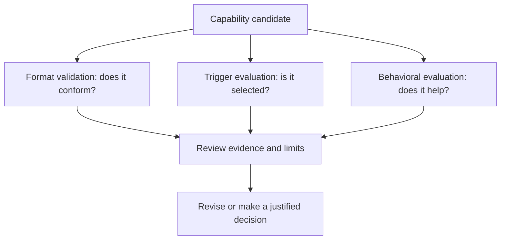

# Concepts: purpose before packaging

Start with the outcome you want the agent to achieve. Only then decide which files and host features are necessary.

## Skill, custom agent, hook, or plugin?

| Concept | Purpose | Example | Boundary |
|---|---|---|---|
| Skill | Reuse a focused workflow and its resources | Summarize decisions from Markdown | Agent Skills format; discovery depends on the host |
| Custom agent | Give a delegated role its own instructions | A reviewer focused on authentication risks | Recorded Goose custom-agent contract |
| Lifecycle hook | React to an event in the host lifecycle | Record selected tool activity | Executable, host-specific behavior |
| Plugin | Distribute capabilities together | A release-note Skill plus integrations | Portable core plus explicit host adapters |
| Script packaging | Make executable resources installable | A contained TypeScript CLI runtime | Packaging guidance, not release approval |

A plugin is not simply a bigger Skill. It introduces package-level discovery, configuration, integration, and release concerns. A custom agent is not a place to declare MCP transports or credentials.

## Three questions, three kinds of evidence

**Validation** checks files and contracts. **Trigger evaluation** checks whether the host selects a Skill for appropriate requests. **Behavioral evaluation** compares outcomes when a capability is used. Passing one does not establish the others.

For a summary Skill, a positive trigger case might ask to extract decisions from meeting notes; a negative case might ask for a translation only. A behavioral case checks whether the summary actually preserves decisions and avoids inventing answers.

## Portable format is not portable execution

The supported portable plugin target is **Agent Plugins 1.0.0**. Its core uses a required root `plugin.json`, optional immediate Skill directories under `skills/`, and optional root `mcp.json`. Portable 1.0.0 does not define hooks or custom agents.

The recorded Goose adapter describes additional behavior. For example, the audited Goose plugin MCP loader defaults to `.mcp.json`, not portable `mcp.json`, and supports stdio conversion rather than all portable remote transports. Let Plugin Creator validate the portable artifact and the intended host separately; do not infer runtime support from a valid schema.

The recorded 1.1.0 draft is inactive, not a supported generation target. See the [portable conformance reference](https://github.com/bioinfornatics/agent-plugins/blob/develop/skills/plugin-creator/references/portable-conformance.md) and [Goose adapter snapshot](https://github.com/bioinfornatics/agent-plugins/blob/develop/skills/plugin-creator/references/goose-plugin-format.md).

## Progressive disclosure and containment

A Skill starts with `SKILL.md`; supporting references, scripts, and assets belong inside that Skill's directory. Keep the central workflow short and directly link deeper details where needed. Copying only `SKILL.md` can omit essential resources.

For this distribution, Git-installed executable creators contain compiled JavaScript and production dependencies in their own `runtime/`. They must not depend on another Skill or root authoring sources at runtime. Native archives replace that Node payload with platform executables; the two payload modes must not be mixed.

## Scope and trust

Project-local installation affects a project; user installation exposes a capability more widely. Goose uses `.agents/skills/` and `~/.agents/skills/` for standalone Skills. These paths are an installation convention, not the Agent Skills file-format specification.

Instructions, hooks, and scripts can influence commands and file writes. A manifest does not sandbox a process. Review side effects, external requirements, credential handling, and failure behavior before enabling a capability.

## Check your understanding

If a plugin validates but no paired runs exist, its behavior is **not evaluated**. If a Skill works in one Goose scenario, that does **not** establish another host's compatibility. If a required reviewer is unavailable, keep the decision **blocked**, not passed.

**Next:** [Getting started](getting-started.md), [creator selection](how-to/creators.md), or [evaluation](how-to/evaluate.md).
