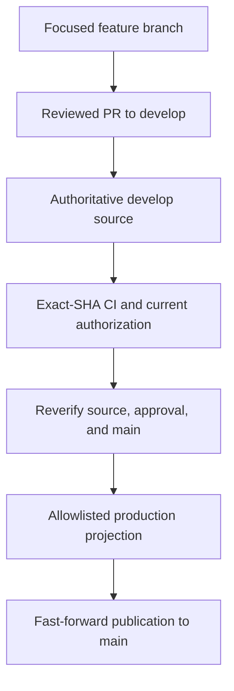

# Contributing

The goal of a contribution is a reviewable change with reproducible evidence—not a hand-edited installation tree. Think of **develop as the workshop** and **main as the packaged product**.

## Understand the branch lifecycle



Feature PRs target `develop`. That branch contains sources, tests, configuration, vendored dependencies, and generated Skill runtime mirrors. `main` is the generated Git-installable distribution; it deliberately excludes root authoring apps and build tooling.

A same-repository `develop` → `main` PR is a **promotion review request**, not a source merge. Publication creates a generated-tree commit with previous `main` as its sole parent, pushes normally, and closes the PR without merging. Never merge `develop` into `main` or force-push production.

The policy and publication permissions are repository-specific. The upstream migration is recorded; ServierHub publication has separate permissions and migration considerations. Do not change credentials or remotes to work around them.

## Prepare a scoped contribution

1. Read [AGENTS.md](https://github.com/bioinfornatics/agent-plugins/blob/develop/AGENTS.md), the affected creator guide, and existing issues.
2. Follow the repository's Beads guidance for tracking. `bd prime` explains the workflow; `bd ready` shows available work. Explicit user or orchestrator restrictions still take precedence.
3. Inspect your checkout and preserve existing changes. Start a focused feature branch from `develop`.
4. State acceptance criteria and the exact evidence needed in the PR.

For a fresh upstream checkout:

```bash
git clone --branch develop https://github.com/bioinfornatics/agent-plugins.git
cd agent-plugins
git switch -c feature/my-change
```

This is contributor source setup, not the ServierHub installation command. Creating a branch does not authorize an automated agent to commit, push, or synchronize tracker remotes.

## Restore development dependencies

Contributor prerequisites include Node.js 22+, pinned Bun 1.3.12, Git, and Beads. Full integration verification needs the recorded Goose 1.47.0 executable and applicable browser tooling. Native release packaging has additional archive tools and platform runners.

In a fresh development checkout:

```bash
node scripts/prepare-development.mjs
```

This restores the verified vendored dependency closure offline, without network installation or lifecycle scripts. It refuses to overwrite existing development modules. Inspect an existing checkout rather than deleting dependencies blindly. Dependency upgrades require deliberate lockfile and vendored-closure changes.

## Edit sources, then regenerate deliverables

| Location | Purpose |
|---|---|
| `apps/<creator>-cli/` | TypeScript sources, tests, generated `dist/` |
| `contracts/` | Shared contracts and compatibility fixtures |
| `skills/<name>/` | Independently installable instructions and resources |
| `skills/<name>/runtime/` | Generated compiled implementation and production dependencies |
| `config/skill-runtimes/` | Versioned app-to-Skill mapping |
| `config/reproducibility/` | Versioned source closure and platform rules |
| `vendor/` | Verified offline build dependencies |
| `.artifacts/` | Disposable previews and build outputs |

Fix implementation sources, not generated runtime files. For a focused Skill Creator change:

```bash
(cd apps/skill-creator-cli && npm run build && npm test)
npm run build:skill-runtimes
npm run check:skill-runtime-dist-drift
```

Changes to shared contracts or other apps need their own builds and fixture refreshes before runtime generation. Follow the complete build order in [CONTRIBUTING.md](https://github.com/bioinfornatics/agent-plugins/blob/develop/CONTRIBUTING.md). Retain regenerated mirrors with the source candidate; CI rebuilds and rejects committed-output drift. The clean rebuild command is a drift gate, not a way to bless stale outputs.

## Verify the exact candidate

| Command | Main scope |
|---|---|
| `npm run test:distribution` | Distribution structure and adoption documentation |
| `npm run test:production` | Projection, containment, provenance, promotion guards |
| `npm run test:production-ci` | Routine production profile and creator/integration checks |
| `npm test` | Full developer suite, including applicable packaging checks |
| `npm run test:reproducibility-build` | Isolated clean-source build reproducibility |
| `npm run test:reproducibility` | Exhaustive isolated verification |

Before release, run each creator app's `npm run build && npm test` and the required root gates. Automated tests must not mutate live `~/.agents` directories. Missing tools or behavioral evidence are limits, not passes.

Routine CI verifies the **exact source head SHA**, not a synthetic merge tree. It restores dependencies, clean-builds, checks output coherence, tests the production profile, and checks deterministic projection and isolated Git installation/update. Five-platform release packaging is deferred from routine CI; scheduled/manual exhaustive and tagged-release workflows cover their applicable packaging checks.

## Preview without publishing

Use a destination that does not already exist:

```bash
node scripts/production.mjs project .artifacts/production-preview
node scripts/production.mjs verify .artifacts/production-preview
node scripts/production.mjs smoke .artifacts/production-preview
```

**Success check:** the preview passes the applicable projection and smoke checks and contains self-contained Skills rather than root authoring dependencies. This preview is not publication or approval. A recorded HEAD from an uncommitted working tree does not prove that edits are committed; release verification needs a clean exact-SHA candidate.

## Respect promotion and authorization limits

Normal promotion requires independent current-SHA approval and successful exact-head CI, followed by source and authorization reverification. Stale approvals, self-approval, forks, or outstanding change requests do not qualify. A personal repository owner may explicitly authorize owner-manual promotion with exact source/main bindings; that is **owner authorization, not independent review**.

Workflow guards are not configured branch protection. Required checks and publisher permissions must be configured separately, and review checks are not atomic with GitHub reviews. If publication succeeds but PR closure fails, inspect provenance before retrying. Follow the [branch migration and rollback policy](https://github.com/bioinfornatics/agent-plugins/blob/develop/docs/branch-migration.md) rather than improvising publication commands.

## Documentation, cleanup, and handoff

Keep user explanations separate from contributor tooling. The production README source is `docs/production-README.md`; links from production to deeper development files need full `develop` URLs. Add new canonical sources to the reproducibility manifest as required by repository policy.

Skill metadata and instructions remain **English**, with concise third-person descriptions and `SKILL.md` at most 500 lines. Move deeper detail into directly linked references. Refresh vendored snapshots before changing a public format contract, preserve evaluation evidence, and keep every Skill independently installable. Bilingual site prose does not change Skill authoring contracts.

Routine cleanup preserves Skill runtimes, vendor dependencies, evaluation evidence, and `.agents/` content. Do not use broad deletion commands in their place. At handoff, report changed files, exact checks, limitations, tracker status when applicable, and proposed next actions. Commit, push, and Dolt remote synchronization require explicit authority under the conservative policy.

**Further reading:** [Full contributing guide](https://github.com/bioinfornatics/agent-plugins/blob/develop/CONTRIBUTING.md), [Reference](reference.md), and [evaluation guidance](how-to/evaluate.md).
