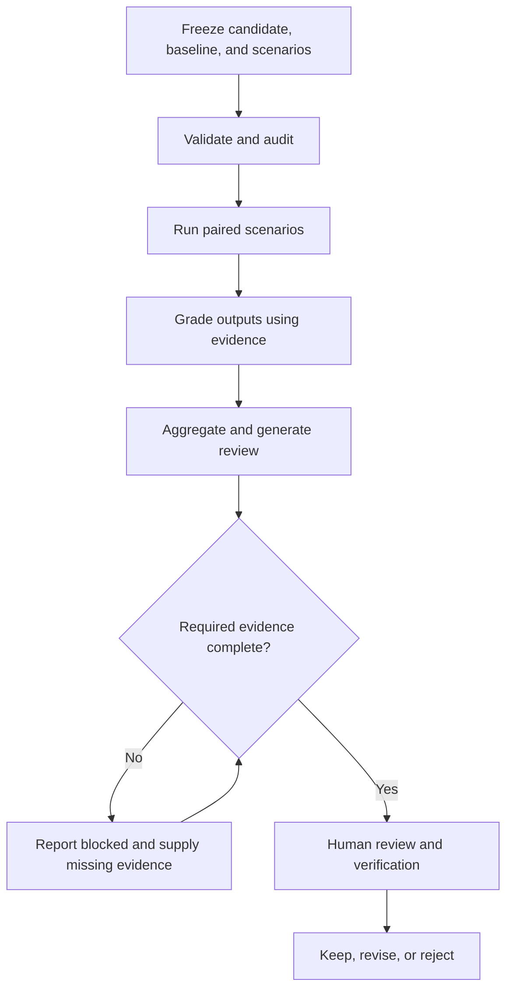

# Evaluate and improve from evidence

The purpose of evaluation is to make a decision you can justify: keep, revise, or reject a capability. It is not to generate a favorable score. Start with realistic tasks and an explicit baseline.

## 1. Separate the questions

Format validation asks whether files conform. Trigger evaluation asks whether a Skill is selected appropriately. Behavioral evaluation asks whether using it helps on the tested tasks. Human review decides whether the evidence and trade-offs are acceptable.



## 2. Choose cases that can expose failure

For the [summary tutorial](../tutorials/first-skill.md), include explicit decisions, discussion only, an unresolved question, and a document with no relevant content. Assertions should distinguish accurate extraction from plausible invention.

Example criterion: “The answer preserves the question about who reviews the examples without naming a reviewer.” This is more useful than “The answer is good.” Keep deterministic checks and qualitative review questions distinct, and use the same fixtures for both variants.

Freeze the candidate, evaluation plan, and baseline before running. Compare `with_skill` with `old_skill` or `without_skill`; do not compare unrelated tasks or silently change the conditions between variants.

## 3. Request paired evaluation

> Use `agent-plugins:skill-creator` to evaluate `.agents/skills/markdown-summary` against a without-Skill baseline on the same realistic scenarios. Preserve paired outputs, grade every run using explicit evidence, aggregate the benchmark, and generate a static HTML review. Identify regressions and trade-offs. Report missing execution, grading, timing, tests, or human review as blocked; recommend only evidence-backed changes.

For shell workflows, use the installed stable executable, not a source `dist/` path. The following paths are placeholders:

```bash
skill-creator full-eval /path/to/skill --workspace /path/to/workspace --dry-run
skill-creator full-eval /path/to/skill --workspace /path/to/workspace --execute --model <model>
```

Choose a real configured model; execution may consume provider resources and needs a supported runner. Dry-run is non-mutating. Without `--execute`, the orchestrator does not invoke an LLM and reports the evidence needed to continue. Completed artifacts are preserved on rerun or resume.

The recorded run profiles are `fast`, `standard`, and `release`, with 1, 3, and 5 deterministic counterbalanced pairs per scenario. Repeated profiles require sufficient evaluation budget. One pair is a diagnostic, not convincing evidence of stable gains. See the [Skill Creator guide](https://github.com/bioinfornatics/agent-plugins/blob/develop/skills/skill-creator/README.md) for precise orchestration requirements.

## 4. Inspect artifacts, not just a headline

Look for paired outputs and grading, `benchmark.json`, `benchmark.md`, a static report such as `review.html`, and a source-bound `receipt.json`. The receipt binds the Skill, plan, execution evidence, benchmark, review, and analysis to hashes; changed inputs require fresh applicable evidence.

Read individual failures and disagreements. Check which timing or resource observations are actually available before claiming efficiency. Missing metrics are not zeros. A strong average can hide a material regression.

## 5. Resolve review checkpoints honestly

Skill Creator uses exit code **3** for blocked verification or execution. A human-review checkpoint may mean automated phases completed but a real decision is still needed—not that evaluation failed or passed.

After actual review and tests have passed, the documented resume form is:

```bash
skill-creator full-eval /path/to/skill --workspace /path/to/workspace --resume --human-review pass --tests-status pass
```

Do not supply pass flags as a substitute for doing the review or tests. Record their provenance and limits. Unavailable runner, model, grader, or reviewer capability must remain explicit; simulated execution is not behavioral approval.

## 6. Improve without losing the baseline

Preserve failed outputs and previous versions. Propose a bounded change tied to a failure, rerun both variants where required, and look for new regressions. The evidence-loop workflow records proposed, challenged, approved, and measured revisions in a separate ledger rather than silently editing the source Skill.

You may conclude “better on these cases,” “regressed on this case,” or “inconclusive.” Do not generalize beyond scenario coverage or confuse successful format validation with improvement.

## Evaluate other capability types

Custom agents use isolated delegation and neutral or earlier-agent baselines. Hook evaluation combines handler tests, side-effect review, and applicable host integration. Whole-plugin evaluation coordinates component receipts with routing, trigger overlap, hook effects, and cross-component handoffs.

Plugin Creator's full-eval orchestrator does **not** run or simulate an LLM. It requests missing specialist and integration evidence and stops blocked until requirements are met. Its workspace must be a proper subdirectory of the plugin's `evaluations/` directory. See [Plugin Creator evaluation](https://github.com/bioinfornatics/agent-plugins/blob/develop/skills/plugin-creator/README.md) and [typed component evidence](https://github.com/bioinfornatics/agent-plugins/blob/develop/skills/plugin-creator/references/component-evidence.md).

## Success check and limits

A useful handoff identifies the exact candidate and baseline, scenarios, artifacts, verdict, regressions, missing evidence, and next action. Validation, evaluation, packaging, and production authorization remain distinct. No evaluation can establish untested host compatibility or guarantee correctness on all future inputs.

**Next:** [Reference](../reference.md) or [Contributing](../contributing.md).
