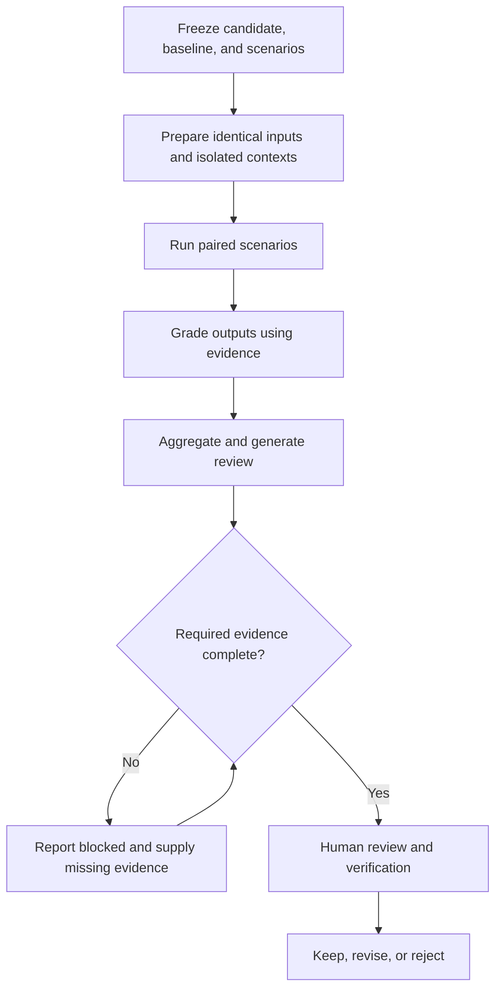

# Evaluate and improve from evidence

The purpose of evaluation is to make a decision you can justify: keep, revise, or reject a capability. It is not to generate a favorable score. Start with realistic tasks and an explicit baseline.

## 1. Separate the questions

Format validation asks whether files conform. Trigger evaluation asks whether a Skill is selected appropriately. Behavioral evaluation asks whether using it helps on the tested tasks. Human review decides whether the evidence and trade-offs are acceptable.



## 2. Choose cases that can expose failure

For the [summary tutorial](../tutorials/first-skill.md), include explicit decisions, discussion only, an unresolved question, and a document with no relevant content. Assertions should distinguish accurate extraction from plausible invention.

Example criterion: “The answer preserves the question about who reviews the examples without naming a reviewer.” This is more useful than “The answer is good.” Keep deterministic checks and qualitative review questions distinct, and use the same fixtures for both variants.

Freeze the candidate, evaluation plan, and baseline before running. Compare `with_skill` with `old_skill` or `without_skill`; do not compare unrelated tasks or silently change the conditions between variants.

## 3. Request paired evaluation

> Use `agent-plugins:skill-creator` to evaluate `.agents/skills/markdown-summary` against a without-Skill baseline on its scenarios. Grade every attempt with explicit evidence, export the graded campaign and generate the HTML review. Identify regressions and trade-offs; report missing execution or grading as blocked and recommend only evidence-backed changes.

From a shell, use the installed Skill launcher, not an application source path. `<skill-root>` is the installed skill-creator directory; other paths are placeholders:

```bash
node <skill-root>/scripts/skill-creator.mjs evaluation --skills /path/to/skill --dry-run
node <skill-root>/scripts/skill-creator.mjs evaluation --skills /path/to/skill
```

`--dry-run` validates the sources and prints the trial matrix without host calls. Without it, the evaluator runs paired Goose trials (with and without the selected profile) in a private HOME and stores attempts and evidence in the shared registry. Defaults: Goose, the configured model, 3 repetitions, parallelism 3, 50 turns, no timeout. Execution may consume provider resources; override defaults only on explicit request. Use `--plugin` for a whole Plugin and `--resume <campaign-id>` to continue an interrupted campaign from its frozen plan.

Three repetitions are a small sample, not proof of stable gains. See the [command reference](https://github.com/bioinfornatics/agent-plugins/blob/develop/skills/skill-creator/references/command-contract.md) for exact options.

## 4. Inspect artifacts, not just a headline

`history` and `inspect <campaign-id>` list campaigns, parameters, trials, attempts and evidence locations without executing anything. `grading`, `judgments` and `export <campaign-id> --grading <grade-id>` record and export explicit grades; `scripts/generate-report.mjs --workspace <campaign>/report/export` produces the managed `report/review.html`.

Read individual failures and disagreements, not only the overview cards. Check which timing or resource observations are actually available before claiming efficiency. Missing metrics are not zeros. A strong average can hide a material regression.

## 5. Resolve uncertain results honestly

Technical errors, unavailable grades and inconclusive comparisons remain visible as such; they are neither passes nor failures. Resume with `--retry-uncertain` only when you explicitly authorize fresh attempts; it never bypasses corruption checks or rewrites recorded evidence and grades.

Human review and tests are separate evidence: record who performed them and their limits. Unavailable runner, model, grader or reviewer capability must remain explicit; a dry-run or mock is not behavioral approval.

## 6. Improve without losing the baseline

Preserve failed outputs and previous versions. Propose a bounded change tied to a failure, rerun both variants where required, and look for new regressions. The evidence-loop workflow records proposed, challenged, approved, and measured revisions in a separate ledger rather than silently editing the source Skill.

You may conclude “better on these cases,” “regressed on this case,” or “inconclusive.” Do not generalize beyond scenario coverage or confuse successful format validation with improvement.

## Evaluate other capability types

Current comparative evaluation accepts Skills and composed Plugins, not standalone
agents, hooks or MCP-only benchmarks. Hook handler tests and host integration are
separate evidence. The current evaluator executes authorized Goose trials; the
retired Plugin Creator full-eval orchestrator and typed receipts are not supplied.

## Success check and limits

A useful handoff identifies the exact candidate and baseline, scenarios, artifacts, verdict, regressions, missing evidence, and next action. Validation, evaluation, packaging, and production authorization remain distinct. No evaluation can establish untested host compatibility or guarantee correctness on all future inputs.

**Next:** [Reference](../reference.md) or [Contributing](../contributing.md).

## Current grading reliability and partial comparisons (0.6.2)

Use the current contained CLI workflow in the linked Skill guide, not historical
profile/receipt terminology above. A valid verdict is independent of raw-log
sanitization: known credentials remain protected without interpreting ordinary
escaped prose as another JSON protocol. The bounded structural tool-event reader
helps inspect actual requests and matched responses; mentions or wrapper code alone
are not consultation proof, and incomplete scans cannot prove absence.

Reports distinguish With/Without selected coverage, inconclusive evidence and
technical failures. A missing baseline verdict is not a zero With-profile score.
Historical resolved errors remain in Details. Regrading requires explicit authority
and appends evidence; rendering a new HTML does not rerun models or rewrite grades.
Future criteria treat no-plugin baseline absence as expected, separately from
artifact quality. Scores across changed criteria must not be treated as equivalent.
