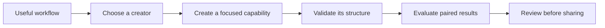

# Agent Plugins

**Turn a useful workflow into a reusable agent capability—and check whether it actually helps.**

A good instruction is not yet a dependable capability. People must be able to find it, understand its boundaries, install its supporting files, and judge its results. Agent Plugins provides focused creators for that journey.

## What will you learn?

You will learn to choose the right kind of capability, create a first Skill, validate its structure, and compare its behavior with a baseline. Maintainers can then learn how verified source becomes an installable distribution.

For example, “summarize meeting notes” is still broad. “Read one Markdown file and separate recorded decisions from open questions, without inventing facts” gives the author and reviewer an observable outcome.

## Choose your learning path

| Your situation | Start here | Then continue |
|---|---|---|
| New to Skills and plugins | [Concepts](concepts.md) | [Getting started](getting-started.md) |
| Ready to make something small | [First Skill tutorial](tutorials/first-skill.md) | [Evaluate and improve](how-to/evaluate.md) |
| Already know your goal | [Choose and use creators](how-to/creators.md) | [Reference](reference.md) |
| Want to change this repository | [Contributing](contributing.md) | Upstream development guidance |

The tutorial is a guided learning exercise. The how-to pages solve specific tasks. The reference is a lookup aid, not a substitute for the walkthrough.

## What is included?

Four creators cover Skills, custom agents, lifecycle hooks, and complete plugins. A fifth Skill, Script Packaging, helps design contained executable resources. [Choose by responsibility](how-to/creators.md), not by whichever creator name looks familiar.

The recorded repository documentation lists distribution **0.5.0**, the portable Agent Plugins **1.0.0** target, and verified host integration with **Goose 1.47.0**. These are recorded verification values, not a claim about the latest releases. Open file formats do not guarantee equivalent behavior in every host.

## Install from the distribution; learn from upstream

The installation URL is **https://github.com/servierhub/agent-plugins.git**. The [ServierHub distribution](https://github.com/servierhub/agent-plugins) and the [personal upstream source](https://github.com/bioinfornatics/agent-plugins) have distinct roles. Deeper documentation links on this site point to upstream `develop`; ready-to-install Skill links point to the distribution's `main`.

Follow [Getting started](getting-started.md) for installation. Git-installed creators require Node.js 22+, but no build, npm dependency installation, or Bun installation. Native release archives are a separate installation mode.

## What counts as success?

You can explain the capability's purpose, inspect its generated files, distinguish validation from evaluation, and identify missing evidence. A blocked or inconclusive evaluation is useful information—not a pass.

Review executable behavior and never package secrets. Goose is the verified reference host; compatibility with other hosts requires testing their own implementation.

**Next:** [Understand the concepts](concepts.md) or [install and check discovery](getting-started.md).
