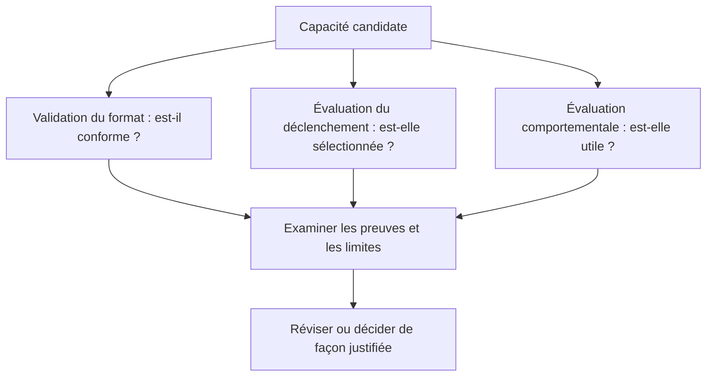

# Concepts : l'objectif avant l'empaquetage

Commencez par le résultat attendu de l'agent. Décidez ensuite des fichiers et des fonctions de l'hôte nécessaires.

## Skill, agent personnalisé, hook ou plugin ?

| Concept | Objectif | Exemple | Limite |
|---|---|---|---|
| Skill | Réutiliser un processus ciblé et ses ressources | Résumer les décisions d'un document Markdown | Format Agent Skills ; découverte selon l'hôte |
| Agent personnalisé | Donner des instructions propres à un rôle délégué | Un relecteur centré sur les risques d'authentification | Contrat Goose consigné pour les agents personnalisés |
| Hook de cycle de vie | Réagir à un événement de l'hôte | Consigner certaines activités d'outils | Comportement exécutable propre à l'hôte |
| Plugin | Distribuer plusieurs capacités ensemble | Un Skill de notes de version avec des intégrations | Noyau portable et adaptateurs d'hôte explicites |
| Empaquetage des scripts | Rendre les ressources exécutables installables | Un environnement CLI TypeScript autonome | Conseil d'empaquetage, pas autorisation de publication |

Un plugin n'est pas simplement un Skill plus volumineux. Il ajoute des enjeux de découverte, de configuration, d'intégration et de publication à l'échelle du paquet. Un agent personnalisé n'est pas l'endroit où déclarer des transports MCP ou des identifiants.

## Trois questions, trois types de preuves

La **validation** contrôle les fichiers et les contrats. L'**évaluation du déclenchement** vérifie si l'hôte sélectionne un Skill pour les demandes appropriées. L'**évaluation comportementale** compare les résultats obtenus avec une capacité. Réussir l'une ne démontre pas les autres.

Pour un Skill de synthèse, un cas positif de déclenchement pourrait demander d'extraire les décisions de notes de réunion ; un cas négatif pourrait demander uniquement une traduction. Un cas comportemental vérifie que la synthèse conserve réellement les décisions sans inventer de réponses.

## Format portable ne signifie pas exécution portable

La cible portable prise en charge est **Agent Plugins 1.0.0**. Son noyau comporte un fichier racine obligatoire `plugin.json`, des répertoires de Skills immédiats facultatifs sous `skills/` et un fichier racine facultatif `mcp.json`. Le format portable 1.0.0 ne définit ni hooks ni agents personnalisés.

L'adaptateur Goose consigné décrit des comportements supplémentaires. Par exemple, le chargeur MCP de plugins Goose audité cherche par défaut `.mcp.json`, et non le fichier portable `mcp.json` ; il convertit les déclarations stdio sans prendre en charge tous les transports distants portables. Faites valider séparément l'artefact portable et l'hôte visé par Plugin Creator ; un schéma valide ne prouve pas la prise en charge à l'exécution.

Le brouillon 1.1.0 consigné est inactif ; ce n'est pas une cible de génération prise en charge. Consultez la [référence de conformité portable](https://github.com/bioinfornatics/agent-plugins/blob/develop/skills/plugin-creator/references/portable-conformance.md) et l'[instantané de l'adaptateur Goose](https://github.com/bioinfornatics/agent-plugins/blob/develop/skills/plugin-creator/references/goose-plugin-format.md).

## Divulgation progressive et autonomie

Un Skill commence par `SKILL.md` ; ses références, scripts et ressources doivent rester dans son propre répertoire. Gardez le processus principal court et liez directement les détails approfondis lorsque c'est nécessaire. Copier uniquement `SKILL.md` peut laisser de côté des ressources essentielles.

Dans cette distribution, les créateurs exécutables installés depuis Git contiennent leur JavaScript compilé et leurs dépendances de production dans leur propre `runtime/`. À l'exécution, ils ne doivent dépendre ni d'un autre Skill ni des sources de développement à la racine. Les archives natives remplacent cette charge Node par des exécutables propres à la plateforme ; les deux modes ne doivent pas être mélangés.

## Portée et confiance

Une installation locale concerne un projet ; une installation utilisateur expose la capacité plus largement. Goose utilise `.agents/skills/` et `~/.agents/skills/` pour les Skills autonomes. Ces chemins sont une convention d'installation, pas la spécification du format Agent Skills.

Instructions, hooks et scripts peuvent influencer les commandes et les écritures de fichiers. Un manifeste n'isole pas un processus dans un bac à sable. Examinez les effets de bord, prérequis externes, traitements des identifiants et comportements en cas d'échec avant d'activer une capacité.

## Vérifiez votre compréhension

Si un plugin est valide mais qu'aucune exécution appariée n'existe, son comportement est **non évalué**. Si un Skill fonctionne dans un scénario Goose, cela ne démontre **pas** sa compatibilité avec un autre hôte. Si un relecteur obligatoire est indisponible, la décision reste **bloquée**, et non réussie.

**Suite :** [Premiers pas](getting-started.md), [choix du créateur](how-to/creators.md) ou [évaluation](how-to/evaluate.md).
