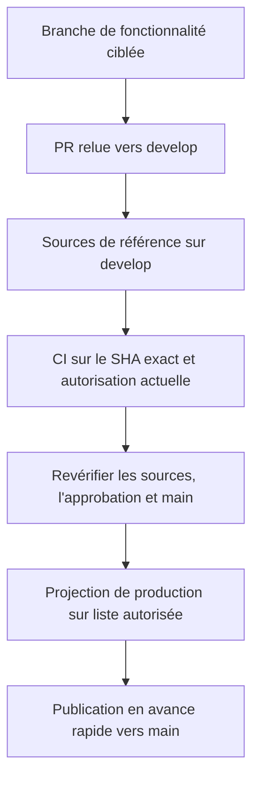

# Contribuer

Une contribution vise un changement facile à relire, accompagné de preuves reproductibles, pas une arborescence d'installation modifiée à la main. Voyez **develop comme l'atelier** et **main comme le produit empaqueté**.

## Comprenez le cycle des branches



Les PR de fonctionnalités ciblent `develop`. Cette branche contient les sources, tests, configurations, dépendances intégrées au dépôt et copies générées des environnements de Skills. `main` est la distribution générée installable depuis Git ; elle exclut volontairement les applications de création et les outils de compilation à la racine.

Une PR `develop` → `main` dans le même dépôt est une **demande de revue de promotion**, pas une fusion des sources. La publication crée un commit d'arborescence générée dont le seul parent est l'ancien `main`, effectue un push normal et ferme la PR sans fusion. Ne fusionnez jamais `develop` dans `main` et ne forcez jamais un push de production.

La politique et les permissions de publication dépendent du dépôt. La migration en amont est consignée ; la publication ServierHub comporte des permissions et considérations de migration distinctes. Ne changez ni identifiants ni remotes pour les contourner.

## Préparez une contribution ciblée

1. Lisez [AGENTS.md](https://github.com/bioinfornatics/agent-plugins/blob/develop/AGENTS.md), le guide du créateur concerné et les problèmes existants.
2. Suivez les consignes Beads du dépôt pour le suivi. `bd prime` explique le processus ; `bd ready` montre les tâches disponibles. Les restrictions explicites de l'utilisateur ou de l'orchestrateur restent prioritaires.
3. Examinez votre copie de travail et préservez les modifications existantes. Créez une branche de fonctionnalité ciblée depuis `develop`.
4. Indiquez dans la PR les critères d'acceptation et les preuves exactes attendues.

Pour une nouvelle copie des sources en amont :

```bash
git clone --branch develop https://github.com/bioinfornatics/agent-plugins.git
cd agent-plugins
git switch -c feature/my-change
```

Il s'agit de préparer les sources pour contribuer, pas de la commande d'installation ServierHub. Créer une branche n'autorise pas un agent automatisé à committer, pousser ou synchroniser les remotes du suivi.

## Restaurez les dépendances de développement

Les prérequis de contribution comprennent Node.js 22+, Bun 1.3.12 épinglé, Git et Beads. La vérification complète des intégrations nécessite l'exécutable Goose 1.47.0 consigné et les outils de navigateur applicables. L'empaquetage natif nécessite aussi des outils d'archive et des machines d'exécution par plateforme.

Dans une nouvelle copie de développement :

```bash
node scripts/prepare-development.mjs
```

Cette commande restaure hors ligne l'ensemble vérifié des dépendances intégrées, sans installation réseau ni scripts de cycle de vie. Elle refuse d'écraser les modules de développement existants. Examinez une copie existante au lieu de supprimer aveuglément des dépendances. Les mises à niveau exigent des changements délibérés du fichier de verrouillage et de l'ensemble des dépendances intégrées.

## Modifiez les sources, puis régénérez les livrables

| Emplacement | Rôle |
|---|---|
| `apps/<creator>-cli/` | Sources TypeScript, tests, `dist/` généré |
| `contracts/` | Contrats partagés et jeux de compatibilité |
| `skills/<name>/` | Instructions et ressources installables indépendamment |
| `skills/<name>/runtime/` | Implémentation compilée générée et dépendances de production |
| `config/skill-runtimes/` | Correspondance versionnée entre applications et Skills |
| `config/reproducibility/` | Ensemble versionné des sources et règles par plateforme |
| `vendor/` | Dépendances de compilation hors ligne vérifiées |
| `.artifacts/` | Aperçus et résultats de compilation jetables |

Corrigez les sources de l'implémentation, pas les fichiers d'exécution générés. Pour un changement ciblé de Skill Creator :

```bash
(cd apps/skill-creator-cli && npm run build && npm test)
npm run build:skill-runtimes
npm run check:skill-runtime-dist-drift
```

Les changements de contrats partagés ou d'autres applications nécessitent leurs compilations et actualisations de jeux de compatibilité avant génération des environnements. Suivez l'ordre complet dans [CONTRIBUTING.md](https://github.com/bioinfornatics/agent-plugins/blob/develop/CONTRIBUTING.md). Conservez les copies régénérées avec le candidat source ; la CI recompile et rejette les écarts avec les sorties committées. La recompilation propre est un contrôle de dérive, pas un moyen de valider des sorties périmées.

## Vérifiez le candidat exact

| Commande | Portée principale |
|---|---|
| `npm run test:distribution` | Structure de distribution et documentation d'adoption |
| `npm run test:production` | Projection, autonomie, provenance, garde-fous de promotion |
| `npm run test:production-ci` | Profil de production courant et contrôles des créateurs/intégrations |
| `npm test` | Suite complète de développement, dont les contrôles d'empaquetage applicables |
| `npm run test:reproducibility-build` | Reproductibilité d'une compilation isolée de sources propres |
| `npm run test:reproducibility` | Vérification isolée exhaustive |

Avant publication, exécutez `npm run build && npm test` dans chaque application de créateur et les contrôles requis à la racine. Les tests automatisés ne doivent pas modifier les répertoires actifs `~/.agents`. Les outils ou preuves comportementales manquants sont des limites, pas des réussites.

La CI courante vérifie le **SHA exact de la tête des sources**, pas un arbre de fusion synthétique. Elle restaure les dépendances, recompile proprement, vérifie la cohérence des sorties, teste le profil de production, puis contrôle la projection déterministe et l'installation/mise à jour Git isolée. L'empaquetage sur cinq plateformes est différé hors de la CI courante ; les workflows exhaustifs planifiés/manuels et de versions étiquetées couvrent leurs contrôles applicables.

## Prévisualisez sans publier

Utilisez une destination qui n'existe pas encore :

```bash
node scripts/production.mjs project .artifacts/production-preview
node scripts/production.mjs verify .artifacts/production-preview
node scripts/production.mjs smoke .artifacts/production-preview
```

**Critère de réussite :** l'aperçu passe les contrôles applicables de projection et de fonctionnement, et contient des Skills autonomes plutôt que des dépendances de développement à la racine. Cet aperçu n'est ni une publication ni une approbation. Un HEAD consigné depuis une copie comportant des modifications non committées ne prouve pas qu'elles sont committées ; la vérification de publication exige un candidat propre au SHA exact.

## Respectez les limites de promotion et d'autorisation

La promotion normale exige une approbation indépendante pour le SHA actuel et une CI réussie sur cette tête exacte, puis une revérification des sources et de l'autorisation. Les approbations périmées, l'auto-approbation, les forks ou les demandes de modification non résolues ne conviennent pas. Le propriétaire d'un dépôt personnel peut autoriser explicitement une promotion manuelle liée aux sources/main exacts ; c'est une **autorisation du propriétaire, pas une revue indépendante**.

Les garde-fous de workflow ne constituent pas une protection de branche configurée. Les contrôles obligatoires et permissions de publication doivent être configurés séparément ; les vérifications de revue ne sont pas atomiques avec les revues GitHub. Si la publication réussit mais que la fermeture de PR échoue, examinez la provenance avant de réessayer. Suivez la [politique de migration des branches et de retour arrière](https://github.com/bioinfornatics/agent-plugins/blob/develop/docs/branch-migration.md) au lieu d'improviser des commandes de publication.

## Documentation, nettoyage et transmission

Séparez les explications utilisateur des outils de contribution. La source du README de production est `docs/production-README.md` ; les liens depuis la production vers les fichiers de développement approfondis doivent utiliser des URL complètes vers `develop`. Ajoutez les nouvelles sources canoniques au manifeste de reproductibilité selon la politique du dépôt.

Les métadonnées et instructions des Skills restent **en anglais**, avec des descriptions concises à la troisième personne et un `SKILL.md` de 500 lignes au maximum. Déplacez les détails approfondis dans des références directement liées. Actualisez les instantanés intégrés avant de modifier un contrat de format public, préservez les preuves d'évaluation et gardez chaque Skill installable indépendamment. La rédaction bilingue du site ne change pas les contrats de création des Skills.

Le nettoyage courant préserve les environnements des Skills, les dépendances intégrées, les preuves d'évaluation et le contenu de `.agents/`. Ne les remplacez pas par des suppressions générales. Lors de la transmission, indiquez les fichiers modifiés, les contrôles exacts, les limites, l'état du suivi si applicable et les prochaines actions proposées. Commit, push et synchronisation distante Dolt nécessitent une autorisation explicite selon la politique conservatrice.

**Pour approfondir :** [Guide complet de contribution](https://github.com/bioinfornatics/agent-plugins/blob/develop/CONTRIBUTING.md), [Référence](reference.md) et [guide d'évaluation](how-to/evaluate.md).
