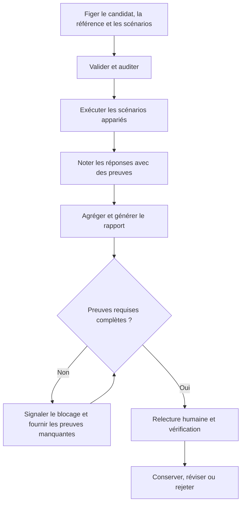

# Évaluer et améliorer à partir de preuves

L'évaluation sert à prendre une décision justifiable : conserver, réviser ou rejeter une capacité. Elle ne sert pas à obtenir une bonne note. Commencez par des tâches réalistes et une référence explicite.

## 1. Séparez les questions

La validation du format vérifie la conformité des fichiers. L'évaluation du déclenchement vérifie si un Skill est sélectionné à bon escient. L'évaluation comportementale vérifie son utilité sur les tâches testées. La relecture humaine juge si les preuves et les compromis sont acceptables.



## 2. Choisissez des cas capables de révéler un échec

Pour le [tutoriel de synthèse](../tutorials/first-skill.md), incluez des décisions explicites, une discussion seule, une question non résolue et un document sans contenu pertinent. Les assertions doivent distinguer une extraction fidèle d'une invention plausible.

Exemple de critère : « La réponse conserve la question sur la relecture des exemples sans nommer de relecteur. » C'est plus utile que « La réponse est bonne ». Distinguez les contrôles déterministes des questions de relecture qualitative, et utilisez les mêmes données pour les deux variantes.

Figez le candidat, le plan d'évaluation et la référence avant l'exécution. Comparez `with_skill` à `old_skill` ou `without_skill` ; ne comparez pas des tâches sans rapport et ne modifiez pas silencieusement les conditions entre variantes.

## 3. Demandez une évaluation appariée

> Utilise `agent-plugins:skill-creator` pour évaluer `.agents/skills/markdown-summary` face à une référence sans Skill sur les mêmes scénarios réalistes. Conserve les réponses appariées, note chaque exécution avec des preuves explicites, agrège le bilan et génère un rapport HTML statique. Identifie les régressions et les compromis. Signale comme bloquées les preuves manquantes d'exécution, de notation, de durée, de tests ou de relecture humaine ; ne recommande que des changements étayés.

En ligne de commande, utilisez l'exécutable stable installé, pas un chemin source `dist/`. Les chemins suivants sont à remplacer :

```bash
skill-creator full-eval /path/to/skill --workspace /path/to/workspace --dry-run
skill-creator full-eval /path/to/skill --workspace /path/to/workspace --execute --model <model>
```

Choisissez un modèle réellement configuré ; l'exécution peut consommer des ressources du fournisseur et nécessite un moteur pris en charge. Le mode dry-run ne modifie rien. Sans `--execute`, l'orchestrateur n'appelle pas de LLM et indique les preuves nécessaires pour continuer. Les artefacts terminés sont conservés lors d'une nouvelle exécution ou reprise.

Les profils consignés sont `fast`, `standard` et `release`, avec 1, 3 et 5 paires déterministes à ordre contrebalancé par scénario. Les profils répétés nécessitent un budget d'évaluation suffisant. Une seule paire est un diagnostic, pas une preuve convaincante de gains stables. Consultez le [guide Skill Creator](https://github.com/bioinfornatics/agent-plugins/blob/develop/skills/skill-creator/README.md) pour les exigences précises d'orchestration.

## 4. Examinez les artefacts, pas seulement le résultat global

Recherchez les réponses appariées et leur notation, `benchmark.json`, `benchmark.md`, un rapport statique tel que `review.html` et un `receipt.json` lié aux sources. Ce reçu lie par des empreintes le Skill, le plan, les preuves d'exécution, le bilan, le rapport et l'analyse ; toute modification d'entrée exige des preuves applicables actualisées.

Lisez les échecs et les désaccords individuels. Vérifiez les observations de durée et de ressources réellement disponibles avant d'affirmer un gain d'efficacité. Une métrique manquante ne vaut pas zéro. Une bonne moyenne peut masquer une régression importante.

## 5. Résolvez honnêtement les points de contrôle de relecture

Skill Creator utilise le code de sortie **3** pour une vérification ou une exécution bloquée. Un point de contrôle de relecture humaine peut signifier que les phases automatisées sont terminées mais qu'une décision réelle reste à prendre, et non que l'évaluation a échoué ou réussi.

Après une relecture et des tests réellement réussis, la reprise documentée est :

```bash
skill-creator full-eval /path/to/skill --workspace /path/to/workspace --resume --human-review pass --tests-status pass
```

Ne fournissez pas les indicateurs pass à la place de la relecture ou des tests. Consignez leur provenance et leurs limites. L'indisponibilité d'un moteur, modèle, évaluateur ou relecteur doit rester explicite ; une exécution simulée n'est pas une approbation comportementale.

## 6. Améliorez sans perdre la référence

Conservez les réponses en échec et les versions précédentes. Proposez un changement limité lié à un échec, réexécutez les deux variantes lorsque c'est nécessaire et cherchez de nouvelles régressions. Le processus evidence-loop consigne les révisions proposées, contestées, approuvées et mesurées dans un registre distinct, sans modifier silencieusement le Skill source.

Vous pouvez conclure « meilleur sur ces cas », « régression sur ce cas » ou « non concluant ». Ne généralisez pas au-delà des scénarios couverts et ne confondez pas conformité du format et amélioration.

## Évaluez les autres types de capacités

Les agents personnalisés utilisent une délégation isolée et une référence neutre ou une version antérieure. L'évaluation des hooks combine tests du gestionnaire, examen des effets de bord et intégration applicable avec l'hôte. L'évaluation du plugin complet coordonne les reçus des composants avec le routage, le chevauchement des déclenchements, les effets des hooks et les passages entre composants.

L'orchestrateur full-eval de Plugin Creator **n'exécute ni ne simule** de LLM. Il demande les preuves spécialisées et d'intégration manquantes, puis reste bloqué tant que les exigences ne sont pas satisfaites. Son espace de travail doit être un sous-répertoire strict du répertoire `evaluations/` du plugin. Consultez l'[évaluation Plugin Creator](https://github.com/bioinfornatics/agent-plugins/blob/develop/skills/plugin-creator/README.md) et les [preuves typées des composants](https://github.com/bioinfornatics/agent-plugins/blob/develop/skills/plugin-creator/references/component-evidence.md).

## Critère de réussite et limites

Une transmission utile précise le candidat exact, la référence, les scénarios, les artefacts, le verdict, les régressions, les preuves manquantes et l'action suivante. Validation, évaluation, empaquetage et autorisation de production restent distincts. Aucune évaluation ne démontre une compatibilité d'hôte non testée ni ne garantit la correction sur toutes les entrées futures.

**Suite :** [Référence](../reference.md) ou [Contribuer](../contributing.md).
