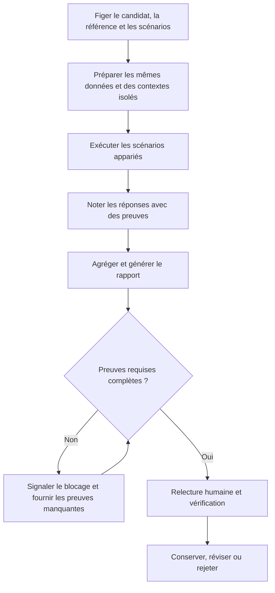

# Évaluer et améliorer à partir de preuves

L'évaluation sert à prendre une décision justifiable : conserver, réviser ou rejeter une capacité. Elle ne sert pas à obtenir une bonne note. Commencez par des tâches réalistes et une référence explicite.

## 1. Séparez les questions

La validation du format vérifie la conformité des fichiers. L'évaluation du déclenchement vérifie si un Skill est sélectionné à bon escient. L'évaluation comportementale vérifie son utilité sur les tâches testées. La relecture humaine juge si les preuves et les compromis sont acceptables.



## 2. Choisissez des cas capables de révéler un échec

Pour le [tutoriel de synthèse](../tutorials/first-skill.md), incluez des décisions explicites, une discussion seule, une question non résolue et un document sans contenu pertinent. Les assertions doivent distinguer une extraction fidèle d'une invention plausible.

Exemple de critère : « La réponse conserve la question sur la relecture des exemples sans nommer de relecteur. » C'est plus utile que « La réponse est bonne ». Distinguez les contrôles déterministes des questions de relecture qualitative, et utilisez les mêmes données pour les deux variantes.

Figez le candidat, le plan d'évaluation et la référence avant l'exécution. Comparez `with_skill` à `old_skill` ou `without_skill` ; ne comparez pas des tâches sans rapport et ne modifiez pas silencieusement les conditions entre variantes.

## 3. Demandez une évaluation appariée

> Utilise `agent-plugins:skill-creator` pour évaluer `.agents/skills/markdown-summary` face à une référence sans Skill sur ses scénarios. Note chaque tentative avec des preuves explicites, exporte la campagne notée et génère le rapport HTML. Identifie les régressions et les compromis ; signale comme bloquées l'exécution ou la notation manquantes et ne recommande que des changements étayés.

En ligne de commande, utilisez le lanceur du Skill installé, pas un chemin source de l'application. `<skill-root>` est le répertoire skill-creator installé ; les autres chemins sont à remplacer :

```bash
node <skill-root>/scripts/skill-creator.mjs evaluation --skills /path/to/skill --dry-run
node <skill-root>/scripts/skill-creator.mjs evaluation --skills /path/to/skill
```

`--dry-run` valide les sources et affiche la matrice d'essais sans appeler l'hôte. Sans cette option, l'évaluateur exécute des essais Goose appariés (avec et sans le profil choisi) dans un HOME privé et enregistre tentatives et preuves dans le registre partagé. Valeurs par défaut : Goose, le modèle configuré, 3 répétitions, parallélisme 3, 50 tours, sans délai maximal. L'exécution peut consommer des ressources du fournisseur ; ne modifiez les valeurs par défaut que sur demande explicite. Utilisez `--plugin` pour un Plugin complet et `--resume <campaign-id>` pour reprendre une campagne interrompue à partir de son plan figé.

Trois répétitions sont un petit échantillon, pas une preuve de gains stables. Consultez la [référence des commandes](https://github.com/bioinfornatics/agent-plugins/blob/develop/skills/skill-creator/references/command-contract.md) pour les options exactes.

## 4. Examinez les artefacts, pas seulement le résultat global

`history` et `inspect <campaign-id>` listent campagnes, paramètres, essais, tentatives et emplacements des preuves sans rien exécuter. `grading`, `judgments` et `export <campaign-id> --grading <grade-id>` enregistrent et exportent des notes explicites ; `scripts/generate-report.mjs --workspace <campaign>/report/export` produit le rapport géré `report/review.html`.

Lisez les échecs et les désaccords individuels, pas seulement les cartes de synthèse. Vérifiez les observations de durée et de ressources réellement disponibles avant d'affirmer un gain d'efficacité. Une métrique manquante ne vaut pas zéro. Une bonne moyenne peut masquer une régression importante.

## 5. Traitez honnêtement les résultats incertains

Les erreurs techniques, notes indisponibles et comparaisons non concluantes restent visibles comme telles ; ce ne sont ni des réussites ni des échecs. Ne reprenez avec `--retry-uncertain` que si vous autorisez explicitement de nouvelles tentatives ; cette option ne contourne jamais les contrôles d'intégrité et ne réécrit ni les preuves ni les notes enregistrées.

La relecture humaine et les tests sont des preuves distinctes : consignez qui les a réalisés et leurs limites. L'indisponibilité d'un moteur, modèle, évaluateur ou relecteur doit rester explicite ; un dry-run ou un mock n'est pas une approbation comportementale.

## 6. Améliorez sans perdre la référence

Conservez les réponses en échec et les versions précédentes. Proposez un changement limité lié à un échec, réexécutez les deux variantes lorsque c'est nécessaire et cherchez de nouvelles régressions. Le processus evidence-loop consigne les révisions proposées, contestées, approuvées et mesurées dans un registre distinct, sans modifier silencieusement le Skill source.

Vous pouvez conclure « meilleur sur ces cas », « régression sur ce cas » ou « non concluant ». Ne généralisez pas au-delà des scénarios couverts et ne confondez pas conformité du format et amélioration.

## Évaluez les autres types de capacités

L’évaluation comparative actuelle accepte les Skills et les Plugins composés, pas
les agents, hooks ou benchmarks MCP seuls. Les tests de handlers et l’intégration
avec l’hôte sont des preuves distinctes. L’évaluateur actuel exécute les essais Goose
autorisés ; l’ancien orchestrateur full-eval et ses reçus typés ne sont plus fournis.

## Critère de réussite et limites

Une transmission utile précise le candidat exact, la référence, les scénarios, les artefacts, le verdict, les régressions, les preuves manquantes et l'action suivante. Validation, évaluation, empaquetage et autorisation de production restent distincts. Aucune évaluation ne démontre une compatibilité d'hôte non testée ni ne garantit la correction sur toutes les entrées futures.

**Suite :** [Référence](../reference.md) ou [Contribuer](../contributing.md).

## Fiabilité de la notation et comparaisons partielles actuelles (0.6.2)

Utilisez le workflow actuel du CLI contenu dans le guide du Skill lié, et non les
anciens profils/reçus décrits ci-dessus. Un verdict valide est indépendant de la
sanitisation des logs : les secrets connus restent protégés sans interpréter le
texte ordinaire avec échappements comme un autre protocole JSON. Le lecteur borné
d’événements structurels aide à inspecter les appels réels et leurs réponses liées ;
une mention ou du code encapsulé ne suffit pas à prouver une consultation, et une
analyse incomplète ne peut pas prouver une absence.

Les rapports distinguent la couverture Avec/Sans plugin, les preuves inconclusives
et les erreurs techniques. Un verdict baseline manquant n’est pas une note zéro
Avec plugin. Les erreurs historiques résolues restent dans Details. Une renotation
exige une autorisation explicite et ajoute des preuves ; générer un nouvel HTML
ne relance aucun modèle et ne réécrit aucun grade. Les futurs critères séparent
l’absence attendue du plugin dans le baseline de la qualité du livrable. Ne comparez
pas comme équivalents les scores obtenus avec des critères modifiés.
