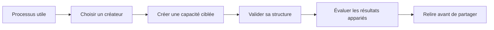

# Agent Plugins

**Transformez un processus utile en capacité réutilisable pour un agent, puis vérifiez qu'elle apporte réellement quelque chose.**

De bonnes instructions ne suffisent pas à rendre une capacité fiable. Il faut pouvoir la découvrir, comprendre ses limites, installer ses ressources et juger ses résultats. Agent Plugins propose des créateurs spécialisés pour parcourir ces étapes.

## Qu'allez-vous apprendre ?

Vous apprendrez à choisir le bon type de capacité, à créer un premier Skill, à valider sa structure et à comparer son comportement à une référence. Les mainteneurs pourront ensuite comprendre comment des sources vérifiées deviennent une distribution installable.

Par exemple, « résumer des notes de réunion » reste vague. « Lire un fichier Markdown et séparer les décisions consignées des questions ouvertes, sans inventer de faits » donne à l'auteur et au relecteur un résultat observable.

## Choisissez votre parcours

| Votre situation | Commencez ici | Poursuivez avec |
|---|---|---|
| Vous découvrez les Skills et les plugins | [Concepts](concepts.md) | [Premiers pas](getting-started.md) |
| Vous souhaitez créer un petit exemple | [Tutoriel : premier Skill](tutorials/first-skill.md) | [Évaluer et améliorer](how-to/evaluate.md) |
| Votre objectif est déjà défini | [Choisir et utiliser les créateurs](how-to/creators.md) | [Référence](reference.md) |
| Vous voulez modifier ce dépôt | [Contribuer](contributing.md) | Documentation de développement en amont |

Le tutoriel est un exercice guidé. Les guides pratiques répondent à des besoins précis. La référence facilite les recherches ponctuelles ; elle ne remplace pas le parcours d'apprentissage.

## Que contient le projet ?

Quatre créateurs couvrent les Skills, les agents personnalisés, les hooks de cycle de vie et les plugins complets. Un cinquième Skill, Script Packaging, aide à concevoir des ressources exécutables autonomes. [Choisissez selon la responsabilité](how-to/creators.md), et non selon le nom qui vous est le plus familier.

La documentation du dépôt indique la distribution **0.5.0**, la cible portable Agent Plugins **1.0.0** et une intégration vérifiée avec **Goose 1.47.0**. Ce sont des valeurs de vérification consignées, pas une affirmation sur les dernières versions disponibles. Des formats ouverts ne garantissent pas un comportement équivalent dans tous les hôtes.

## Installez la distribution ; consultez les sources en amont

L'URL d'installation est **https://github.com/servierhub/agent-plugins.git**. La [distribution ServierHub](https://github.com/servierhub/agent-plugins) et les [sources personnelles en amont](https://github.com/bioinfornatics/agent-plugins) ont des rôles distincts. Les liens documentaires approfondis de ce site pointent vers `develop` en amont ; les liens vers les Skills prêts à installer pointent vers `main` de la distribution.

Suivez les [Premiers pas](getting-started.md) pour l'installation. Les créateurs installés depuis Git nécessitent Node.js 22+, mais aucune compilation, installation de dépendances npm ou installation de Bun. Les archives natives constituent un mode d'installation distinct.

## Comment reconnaître la réussite ?

Vous savez expliquer l'objectif de la capacité, examiner les fichiers générés, distinguer validation et évaluation, et identifier les preuves manquantes. Une évaluation bloquée ou non concluante fournit une information utile : ce n'est pas une réussite.

Relisez les comportements exécutables et n'incluez jamais de secrets. Goose est l'hôte de référence vérifié ; la compatibilité avec les autres hôtes exige des tests de leur propre implémentation.

**Suite :** [Comprendre les concepts](concepts.md) ou [installer et vérifier la découverte](getting-started.md).
